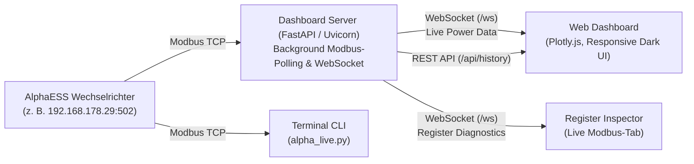

# AlphaESS Live Data & Dashboard

Echtzeit-Monitoring und lokales Web-Dashboard für **AlphaESS Photovoltaik-Hybrid-Wechselrichter** und Batteriespeicher (z. B. SMILE-Serie) über **Modbus TCP**.

Dieses Projekt liest sekundengenaue Messwerte direkt aus dem Wechselrichter über das lokale Netzwerk aus, stellt sie über einen WebSocket-Stream bereit und visualisiert Leistungsflüsse, Batteriezustand und Verbrauchsdaten in einem responsiven Web-Dashboard – ganz ohne Cloud-Zwang oder Hersteller-API-Beschränkungen.

---

## 🌟 Features

- **Direkte Modbus-TCP-Kommunikation**: Lokale Abfrage ohne Internetverbindung, Cloud oder Hersteller-API-Limits (Standard-Port `502`, Unit ID `85`).
- **Echtzeit-Streaming per WebSocket**: Sekündliche Übertragung von PV-Erzeugung, Netzbezug/Einspeisung, Hauslast sowie Batterieleistung und Ladezustand (SoC).
- **Modernes Web-Dashboard**:
  - Übersichtliche Kacheln für Solarleistung, Hausverbrauch, Netz-Status und Batterie.
  - Interaktive Verlaufsdiagramme (Plotly.js) mit anpassbaren Zeitfenstern.
  - Rolling In-Memory Cache (bis zu 24 Stunden) für sofortige Visualisierung ohne externe Datenbank.
  - Dynamischer **Modbus Register-Explorer**: Durchsuchen und Live-Inspektion aller holding register des Inverters.
- **Konsolen-Monitor (`alpha_live.py`)**: Schlankes CLI-Skript für tabellarische Terminal-Ausgaben in Echtzeit.
- **Register-Scanner & Diagnose (`check_registers.py`)**: Automatisierte Überprüfung und Validierung der Modbus-Register basierend auf der Spezifikation.
- **Raspberry Pi Ready**: Optimiert für den 24/7-Dauerbetrieb auf einem Raspberry Pi inklusive systemd-Service ([Anleitung](file:///c:/repos/alphaESS-live-data/raspberry-pi-deploy.md)).

---

## 🏗️ Systemarchitektur



---

## 📁 Dateistruktur

```text
alphaESS-live-data/
├── dashboard/
│   └── index.html               # Frontend: Modernes Dark-Mode Web-Dashboard mit Plotly.js & Register-Tab
├── .gitignore                   # Git-Ausschlussregeln (virtuelle Umgebungen, Caches etc.)
├── alpha_ess_register.pdf       # Offizielle AlphaESS Modbus-Holding-Register-Dokumentation
├── alpha_live.py                # Standalone-CLI-Skript: Sekundengenaues Auslesen im Terminal
├── check_registers.py           # Diagnose-Tool: Prüft Inverter-Register und exportiert register.json
├── dashboard_server.py          # FastAPI-Backend: Modbus-Polling, WebSocket-Server, REST-APIs & Webserver
├── holding_register.txt         # Tabellarische Liste bekannter Register (Adressen, Typen, Faktoren, Einheiten)
├── raspberry-pi-deploy.md       # Detaillierte Schritt-für-Schritt-Anleitung für Raspberry Pi & systemd
├── register.json                # Maschinenlesbare Register-Definitionen und Scan-Ergebnisse
├── requirements.txt             # Python-Paketabhängigkeiten (pyModbusTCP, fastapi, uvicorn)
└── README.md                    # Projektdokumentation und Übersicht
```

### Dateibeschreibungen im Detail

| Datei / Verzeichnis | Beschreibung |
|---|---|
| [`dashboard/index.html`](file:///c:/repos/alphaESS-live-data/dashboard/index.html) | Single-Page-Anwendung mit HTML5, CSS3 und JavaScript. Verbindet sich per WebSocket mit dem Server, rendert Live-Werte, historische Leistungsdiagramme und bietet eine tabellarische Register-Ansicht mit Filterfunktion. |
| [`dashboard_server.py`](file:///c:/repos/alphaESS-live-data/dashboard_server.py) | Hauptserver basierend auf FastAPI und Uvicorn. Startet zwei asynchrone Tasks: einen für das sekündliche Auslesen der Kern-Messwerte und einen für das bedarfsgesteuerte Register-Polling bei geöffnetem Diagnose-Tab. |
| [`alpha_live.py`](file:///c:/repos/alphaESS-live-data/alpha_live.py) | Minimalistisches Python-Skript zur schnellen Diagnose im Terminal ohne Webserver. Zeigt Netz, Solar, Last, Batterie-Power, SoC und gespeicherte Energie formatiert an. |
| [`check_registers.py`](file:///c:/repos/alphaESS-live-data/check_registers.py) | Liest `holding_register.txt` ein, testet alle definierten Adressen gegen den echten Wechselrichter und generiert `register.json` mit getrennten Listen für verfügbare und fehlerhafte Register. |
| [`holding_register.txt`](file:///c:/repos/alphaESS-live-data/holding_register.txt) | Tab-separierte Register-Definitionstabelle mit Adressen, Beschreibungen, Datentypen (`uint16be`, `int16be`, `uint32be`, `int32be`, `string`), Skalierungsfaktoren und Einheiten. |
| [`register.json`](file:///c:/repos/alphaESS-live-data/register.json) | Durch `check_registers.py` generierter JSON-Katalog aller ansprechbaren Register des Wechselrichters inklusive formatierter Metadaten. |
| [`raspberry-pi-deploy.md`](file:///c:/repos/alphaESS-live-data/raspberry-pi-deploy.md) | Ausführlicher Leitfaden zur Einrichtung auf einem Raspberry Pi (Installation, Autostart via systemd, feste IP-Konfiguration, Wartung). |
| [`alpha_ess_register.pdf`](file:///c:/repos/alphaESS-live-data/alpha_ess_register.pdf) | Herstellerdokumentation mit der Modbus-RTU/TCP-Registerspezifikation für AlphaESS-Systeme. |
| [`requirements.txt`](file:///c:/repos/alphaESS-live-data/requirements.txt) | Liste der benötigten Python-Bibliotheken (`pyModbusTCP`, `fastapi`, `uvicorn[standard]`). |

---

## ⚙️ Voraussetzungen

- Python 3.10 oder neuer
- Netzwerkzugriff auf den AlphaESS-Wechselrichter über WLAN oder LAN (Port 502 muss im Inverter freigegeben/erreichbar sein)
- Die IP-Adresse des Inverters im Heimnetz (z. B. `192.168.178.55`)

---

## 🚀 Schnellstart

### 1. Repository klonen & Abhängigkeiten installieren

```bash
git clone <repository-url>
cd alphaESS-live-data

# Virtuelle Umgebung erstellen und aktivieren
python -m venv .venv

# Unter Linux / macOS / Raspberry Pi:
source .venv/bin/activate

# Unter Windows (PowerShell):
.venv\Scripts\Activate.ps1

# Abhängigkeiten installieren
pip install --upgrade pip
pip install -r requirements.txt
```

### 2. Konfiguration anpassen

Öffne [`dashboard_server.py`](file:///c:/repos/alphaESS-live-data/dashboard_server.py) (oder [`alpha_live.py`](file:///c:/repos/alphaESS-live-data/alpha_live.py)) und passe die Parameter an deine Anlage an:

```python
INVERTER_IP = "192.168.178.55"       # IP-Adresse deines AlphaESS-Wechselrichters
PORT = 502                           # Standard Modbus-Port
SLAVE_ID = 85                        # Standard Unit-ID bei AlphaESS
TOTAL_BATTERY_CAPACITY_KWH = 7.68    # Installierte Bruttokapazität deines Batteriespeichers
```

### 3. Server starten

```bash
python dashboard_server.py
```

Das Dashboard ist anschließend erreichbar unter:
👉 **`http://localhost:8000`** *(bzw. `http://<GERÄTE-IP>:8000` im lokalen Netzwerk)*

---

## 📊 Terminal-Live-Monitor (ohne Dashboard)

Falls du nur schnell auf der Konsole prüfen möchtest, ob der Wechselrichter antwortet:

```bash
python alpha_live.py
```

**Beispielausgabe:**
```text
Verbunden mit Inverter 192.168.178.29:502 (Unit-ID: 85)
Starte sekundengenaues Auslesen mit 7.68 kWh Batteriespeicher...

Zeit       | Netz (W)   | Solar (W)  | Last (W)   | Abgeb. Batterie | Batterie-Power  | SoC (%)  | Energie (kWh)
----------------------------------------------------------------------------------------------------------------------
12:30:15   |     -450 W |     2800 W |     1150 W |             0 W |         -1200 W |  82.5 %  |      6.34 kWh
12:30:16   |     -460 W |     2810 W |     1140 W |             0 W |         -1210 W |  82.5 %  |      6.34 kWh
```

---

## 🔍 Register-Inspektion & Scan

Um alle definierten Holding-Register zu testen und zu aktualisieren:

```bash
python check_registers.py
```

Das Skript liest [`holding_register.txt`](file:///c:/repos/alphaESS-live-data/holding_register.txt), fragt jede Adresse ab und aktualisiert [`register.json`](file:///c:/repos/alphaESS-live-data/register.json) mit den tatsächlich lesbaren Werten und Skalierungsregeln.

---

## 🌐 REST & WebSocket Schnittstellen

Der Server stellt folgende Endpunkte bereit:

| Endpunkt | Typ | Beschreibung |
|---|---|---|
| `/` | HTTP GET | Liefert das Web-Dashboard ([`dashboard/index.html`](file:///c:/repos/alphaESS-live-data/dashboard/index.html)) |
| `/ws` | WebSocket | Bidirektionaler Stream: sendet sekündliche Live-Daten, Historie und Diagnosewerte; empfängt Tab-Status |
| `/api/history` | HTTP GET | Gibt den In-Memory-Verlauf der letzten 24 Stunden als JSON-Array zurück |
| `/api/registers` | HTTP GET | Liefert alle Register aus `register.json` angereichert mit aktuellen Live-Werten |
| `/api/registers/live` | HTTP GET | Gibt den aktuellen Snapshot der 5-Sekunden-Register-Messwerte zurück |

---

## 🍓 Raspberry Pi 24/7 Deployment

Eine vollständige Anleitung zur dauerhaften Installation als systemd-Dienst auf einem Raspberry Pi findest du in [`raspberry-pi-deploy.md`](file:///c:/repos/alphaESS-live-data/raspberry-pi-deploy.md).

---

## 📜 Lizenz & Hinweis

Dieses Projekt steht in keiner offiziellen Verbindung zur Alpha ESS Co., Ltd. Die Nutzung erfolgt auf eigene Verantwortung.
