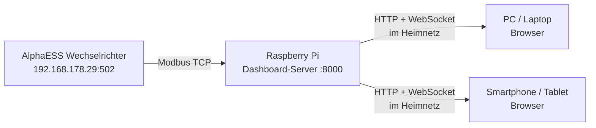

# AlphaESS Dashboard – Raspberry Pi Deployment

> [!IMPORTANT]
> Der Dashboard-Server läuft auf dem **Raspberry Pi** und kommuniziert direkt per Modbus TCP mit dem Wechselrichter. Alle anderen Geräte im Netzwerk (PC, Smartphone, Tablet) greifen per Browser auf den Pi zu.

## Architektur



---

## 1 · Projekt auf den Pi übertragen

> [!NOTE]
> Bei aktuellem Raspberry Pi OS (Bookworm) heißt der Benutzer oft nicht mehr zwingend `pi`, sondern so wie bei der Installation vergeben. Wir nutzen hier den Pfad `/home/$USER/alphaess`, damit es keine Rechteprobleme gibt.

### Option A – Git (empfohlen)
```bash
# Auf dem Raspberry Pi im Terminal:
sudo apt update && sudo apt install -y git python3 python3-pip python3-venv
git clone <dein-repo-url> ~/alphaess
```

### Option B – Direkt per SCP kopieren (ohne Git)
```powershell
# Auf dem Windows-PC im PowerShell:
scp -r C:\repos\alphaESS-live-data <BENUTZERNAME>@<PI-IP>:~/alphaess
```
*(Ersetze `<BENUTZERNAME>` und `<PI-IP>` mit deinen Pi-Zugangsdaten, z.B. `pi@192.168.178.50`)*

---

## 2 · Python-Umgebung einrichten

```bash
cd ~/alphaess
python3 -m venv .venv
source .venv/bin/activate
pip install --upgrade pip
pip install -r requirements.txt
```

> [!TIP]
> Die `requirements.txt` installiert `pyModbusTCP`, `fastapi` und `uvicorn[standard]` (inklusive WebSocket-Unterstützung).

**Einmalig manuell testen:**
```bash
python dashboard_server.py
```
Öffne am PC oder Smartphone im Browser:
`http://<PI-IP>:8000`  
Wenn das Dashboard lädt und Live-Werte anzeigt: Beenden mit `Strg + C`.

---

## 3 · Autostart per systemd einrichten

Damit der Server nach jedem Reboot automatisch im Hintergrund startet und weiterläuft:

### Service-Datei anlegen:
```bash
sudo nano /etc/systemd/system/alphaess-dashboard.service
```

Folgenden Inhalt einfügen (falls dein Benutzer nicht `pi` heißt, passe `User` und die Pfade an):
```ini
[Unit]
Description=AlphaESS Live Dashboard
After=network-online.target
Wants=network-online.target

[Service]
Type=simple
User=pi
WorkingDirectory=/home/pi/alphaess
ExecStart=/home/pi/alphaess/.venv/bin/python dashboard_server.py
Restart=always
RestartSec=5
StandardOutput=journal
StandardError=journal

[Install]
WantedBy=multi-user.target
```
*(Speichern mit `Strg + O`, `Enter` und Beenden mit `Strg + X`)*

### Service aktivieren & starten:
```bash
sudo systemctl daemon-reload
sudo systemctl enable alphaess-dashboard
sudo systemctl start alphaess-dashboard

# Status prüfen (sollte "active (running)" sein):
sudo systemctl status alphaess-dashboard
```

---

## 4 · Feste IP für den Pi (empfohlen)

Am einfachsten direkt im Router (z. B. FRITZ!Box):
1. **Heimnetz → Netzwerk** aufrufen
2. Den Raspberry Pi suchen und auf das **Stift-Symbol (Bearbeiten)** klicken
3. Haken setzen bei: **„Diesem Netzwerkgerät immer die gleiche IPv4-Adresse zuweisen“**
4. Optional eine merkbare IP wählen (z.B. `192.168.178.50`)

---

## 5 · Zugriff im Netzwerk

| Gerät | Adresse |
|---|---|
| Im Browser (PC, Mac, Smartphone, Tablet) | `http://<PI-IP>:8000` (z. B. `http://192.168.178.50:8000`) |
| Per Hostname (mDNS) | `http://raspberrypi.local:8000` *(bzw. dein Pi-Hostname)* |

> [!TIP]
> **Smartphone-Tipp:** Öffne die Seite in Safari (iOS) oder Chrome (Android) und wähle **„Zum Startbildschirm hinzufügen“**. Das Dashboard verhält sich dann wie eine native App ohne störende Browser-Leisten.

---

## 6 · Wichtige Befehle im laufenden Betrieb

```bash
# Live-Logs ansehen (Fehlersuche & Auslesung):
journalctl -u alphaess-dashboard -f

# Dashboard neu starten (z. B. nach Code-Änderungen):
sudo systemctl restart alphaess-dashboard

# Dashboard stoppen:
sudo systemctl stop alphaess-dashboard

# Dashboard Autostart deaktivieren:
sudo systemctl disable alphaess-dashboard
```

---

## 7 · Zukünftige Code-Updates einspielen

Wenn du am PC Änderungen machst:

### Wenn du Git nutzt:
```bash
cd ~/alphaess
git pull
sudo systemctl restart alphaess-dashboard
```

### Ohne Git (vom Windows-PC aus):
```powershell
scp C:\repos\alphaESS-live-data\dashboard_server.py pi@<PI-IP>:~/alphaess/
scp C:\repos\alphaESS-live-data\dashboard\index.html pi@<PI-IP>:~/alphaess/dashboard/
scp C:\repos\alphaESS-live-data\register.json pi@<PI-IP>:~/alphaess/
```
Danach auf dem Pi:
```bash
sudo systemctl restart alphaess-dashboard
```

